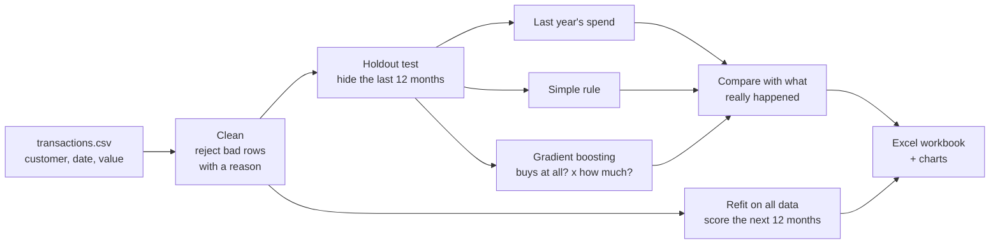
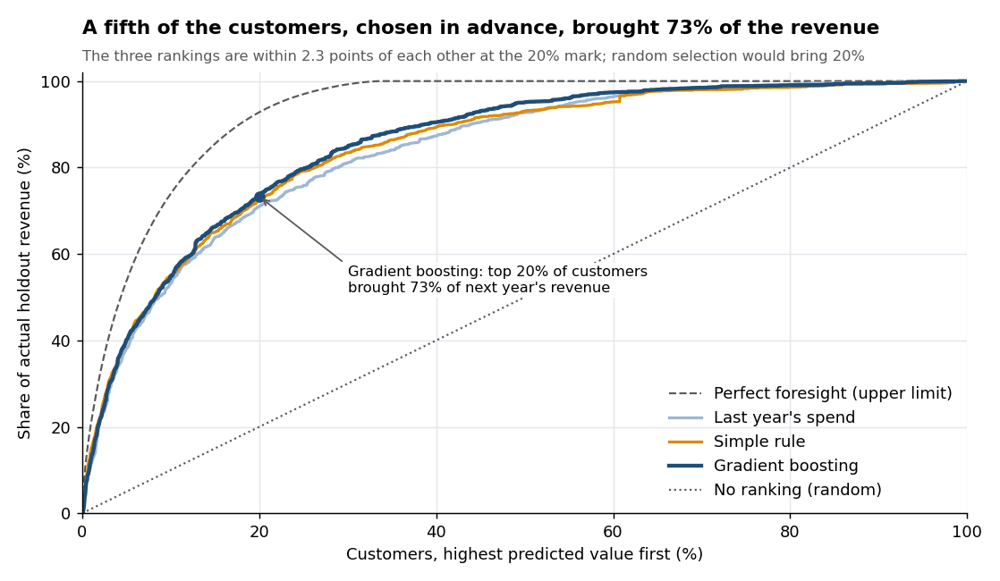
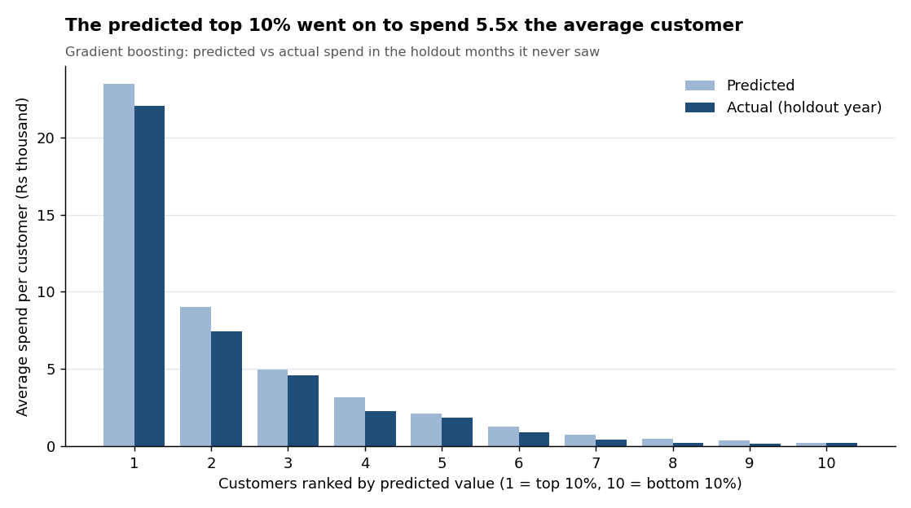

# Customer Lifetime Value Prediction (Python)

Takes a plain order history and estimates what each customer is likely to spend over the next 12 months, so marketing can decide how much each customer is worth spending on. The prediction is not taken on trust: the latest year is hidden, predicted from the earlier years only, and compared with what really happened, side by side with two simpler methods.


---

## The Problem

An online retailer spends the same amount to win and to keep every customer: the same discount code, the same number of reminder messages, the same advertising bid. Yet a small share of customers will bring most of next year's revenue, and many of the others have already stopped buying without telling anyone.

Marketing asks: *"What is each customer likely to spend in the next 12 months, and what is the most we should spend on them?"*

A segmentation of past behaviour (see my [RFM segmentation project](https://github.com/Swami529796/sql-python-customer-segmentation)) describes who **was** valuable. This project predicts who **will be**, and measures how good that prediction is. Customer lifetime value (CLV) here means the predicted spend of one customer over the next 12 months.

## The Solution

```bash
python clv_model.py
```



1. **Clean** the file. Duplicates, rows with no customer, unreadable dates and refunds are set aside and listed with a reason.
2. **Hold out the last 12 months.** Each customer is described using only their orders before the cut-off date (how recently and how often they order, how much, how long they have been a customer, the usual gap between orders, whether order values are rising, how much they vary). The answer to be predicted is their real spend in the 12 months after it.
3. **Compare three approaches** on those hidden 12 months:

   | Approach | How it predicts |
   |---|---|
   | Last year's spend | Next year = what the customer spent in the last 12 months. The baseline any model has to beat. |
   | Simple rule | Average order value x orders per year x chance of still being active. The chance starts at 100% on the day of an order and halves every two "usual gaps" of silence. One line of arithmetic per customer. |
   | Gradient boosting | A machine-learning model in two parts: the chance the customer orders at all, then how much they spend if they do. It learns from earlier cut-off dates whose outcomes were already known. |

4. **Refit on all the data and score every customer** for the coming 12 months: predicted value, chance of being active, value tier and a suggested spend ceiling.

## Results on the Sample Data

Sample: 19,371 clean orders from 4,992 customers, October 2023 to September 2026. The test hides October 2025 to September 2026 and covers the 3,364 customers who had ordered before that. Only 33.7% of them ordered again in the hidden year.

### 1. All three rankings work, and the model is only slightly ahead



```
                       Approach MAE (Rs) Total predicted vs actual % Spearman Revenue in predicted top 10% (%) Revenue in predicted top 20% (%)
              Last year's spend    4,052                       +22.0    0.535                             53.2                             71.0
                    Simple rule    3,502                        +0.2    0.591                             55.0                             72.4
              Gradient boosting    3,877                       +14.0    0.589                             54.9                             73.3
Perfect foresight (upper limit)        0                        +0.0    1.000                             73.9                             92.8
Most revenue in the predicted top 20%: Gradient boosting. Is the gap real? (90% range from 500 re-draws of the customers)
  Gradient boosting minus Simple rule: +0.9 points (range -1.4 to +3.6): too close to call
  Gradient boosting minus Last year's spend: +2.3 points (range +0.9 to +4.3): a real difference
```

How to read the columns:

- **Revenue in predicted top 20%**: rank customers by the prediction, take the top fifth, and see what share of next year's real revenue they brought. This is the number that matters most, because the business acts on a ranked list.
- **Spearman**: how well the predicted order of customers agrees with the real order (1 = identical, 0 = unrelated).
- **MAE** (mean absolute error): the average miss per customer, in rupees.
- **Total predicted vs actual**: whether the approach over- or under-states total revenue.

**What this says, honestly:**

- Any of the three rankings is far better than treating customers alike. The predicted top 20% brought 71% to 73% of next year's revenue; picking a fifth of customers at random would bring 20%.
- **Gradient boosting beats the baseline, but by little:** 2.3 points more revenue in the top 20%, and the 90% range (0.9 to 4.3) stays above zero, so the gain is real.
- **Gradient boosting does not clearly beat the simple rule.** The 0.9 point gap could be luck (the range runs from -1.4 to +3.6), the rule is slightly ahead in the top 10% (55.0% against 54.9%) and on Spearman, and the rule has the lowest error per customer.
- **The rule also gets the total right (+0.2%), the model over-states it by 14%** and last year's spend by 22%. Last year's spend over-states because it assumes nobody leaves. The model over-states because it could only learn from the company's first two years, when every customer was still new; older customers buy a little less than that history suggests.
- Nobody gets near perfect foresight (92.8%). Whether a given customer orders next year is partly chance, and no method can remove that.

If one line of arithmetic is easier to explain to the business than a model, the simple rule is a defensible choice on this data. The model's advantage is that it also gives a tested chance of each customer being active, and it should improve as more years of history become available.

### 2. Predicted against actual, in ten groups



Customers are ranked by the model's prediction and cut into ten equal groups (deciles). All figures are from the hidden year.

| Decile | Customers | Avg predicted (Rs) | Avg actual (Rs) | Bought again % | Share of actual revenue % | Cumulative share % |
|---|---|---|---|---|---|---|
| 1 | 337 | 23,444 | 22,044 | 84.3 | 54.9 | 54.9 |
| 2 | 336 | 9,019 | 7,431 | 68.5 | 18.4 | 73.3 |
| 3 | 337 | 4,990 | 4,608 | 56.7 | 11.5 | 84.8 |
| 4 | 336 | 3,153 | 2,304 | 37.8 | 5.7 | 90.5 |
| 5 | 336 | 2,101 | 1,862 | 36.0 | 4.6 | 95.1 |
| 6 | 337 | 1,288 | 914 | 22.0 | 2.3 | 97.4 |
| 7 | 336 | 768 | 442 | 13.1 | 1.1 | 98.5 |
| 8 | 337 | 473 | 232 | 7.1 | 0.6 | 99.0 |
| 9 | 336 | 357 | 180 | 4.5 | 0.4 | 99.5 |
| 10 | 336 | 243 | 205 | 6.5 | 0.5 | 100.0 |

**What this says:** the order is right almost all the way down, and the predicted amounts are close but a little high in most groups. The top tenth spent Rs 22,044 each, 5.5 times the average customer, and 84% of them bought again. In the bottom three groups fewer than one customer in 14 came back: retention money spent there is mostly wasted.

### 3. Scores for the next 12 months

The model is then refitted on all three years and every customer is scored for October 2026 to September 2027.

| Tier | Customers | Avg predicted value (Rs) | Share of predicted value % | Avg chance of being active % | Avg max spend per customer (Rs) | Total spend ceiling (Rs) |
|---|---|---|---|---|---|---|
| Platinum (top 5%) | 249 | 33,014 | 48.4 | 86.5 | 5,777 | 1,438,591 |
| Gold (next 15%) | 749 | 7,902 | 34.8 | 70.8 | 1,383 | 1,035,693 |
| Silver (next 30%) | 1,498 | 1,638 | 14.4 | 34.7 | 287 | 429,317 |
| Bronze (bottom 50%) | 2,496 | 159 | 2.3 | 6.0 | 28 | 69,572 |

**What this says:** 249 customers are expected to bring almost half of next year's revenue from existing customers, and half of the customer list is expected to bring 2.3%. Spending the same on each of them cannot be right.

**The spend ceiling is a rule of thumb, not a forecast.** It is `predicted value x gross margin x payback months / 12`: with the default 35% margin and a 6-month payback it is the margin a customer is expected to earn in half a year. Spending more than that on one customer takes longer than six months to earn back. It does not say that spending the money will change what the customer does; only a controlled campaign test can show that. Because the model over-stated the total by 14% in the test, treat the ceilings as upper limits. Change the assumptions to match your business:

```bash
python clv_model.py --margin 0.40 --payback-months 9
```

## What It Handles

| Situation | What the script does |
|---|---|
| Your own column names | Set them in `config.yaml` or with `--customer-col`, `--date-col`, `--value-col` |
| CSV or Excel input | Reads `.csv` and `.xlsx` |
| Duplicate rows, missing customer id, unreadable date, zero or negative value | Set aside, counted on the **Data Quality** sheet and listed with the reason on **Rejected Rows** |
| Values typed as `Rs 1,200` | Read as 1200 |
| Leakage (the future slipping into the prediction) | Orders on or after the cut-off are removed inside the feature function, and a training window that would reach past the cut-off is refused. A test rewrites every holdout order and checks that nothing changes. |
| Customers with one order | No "usual gap" exists, so the rule uses the typical gap of repeat customers; the model treats it as missing |
| Customers who joined three weeks ago | Their order rate is not projected from three weeks; a minimum of 180 days is assumed |
| Is the model really better? | The gap between approaches is re-measured on 500 re-draws of the customers and reported with a 90% range |
| Too little history for a holdout test | Stops with a clear message (it needs two prediction windows plus six months) |
| A different horizon, tiers, margin or payback | All in `config.yaml` |

## The Workbook

`output/clv_scores.xlsx`:

| Sheet | Contents |
|---|---|
| Customer Scores | Every customer, best first: predicted 12-month value, chance of being active, tier, spend ceiling, orders and spend to date, last order date, and the simple rule's figure for comparison |
| Decile Table | Predicted against actual by decile, for all three approaches |
| Model Comparison | The comparison table above |
| Tier Summary | Customers, predicted value and spend ceiling by tier |
| Ranking Gaps | The "is the gap real?" check |
| Data Quality, Rejected Rows | What was removed and why |

## How to Use

```bash
pip install -r requirements.txt
```

```bash
python clv_model.py
```

With your own file and column names:

```bash
python clv_model.py --input my_orders.csv --customer-col CustID --date-col "Order Date" --value-col Amount
```

| Option | Default | Description |
|---|---|---|
| `--config` | `config.yaml` | Settings file: column names, horizon, tiers, margin, payback, rule settings |
| `--input` | `data/transactions.csv` | Transaction file, one row per order |
| `--customer-col`, `--date-col`, `--value-col` | from the settings file | Column names in your file |
| `--horizon-months` | `12` | Months to predict ahead; also the length of the holdout |
| `--margin` | `0.35` | Gross margin used for the spend ceiling |
| `--payback-months` | `6` | Months within which the spend must be earned back |
| `--output` | `output/` | Folder for the workbook |
| `--images` | `images/` | Folder for the charts |

Your file needs at least 30 months of orders with the default settings (two 12-month windows plus six months of history).

Rebuild the sample data:

```bash
python make_sample_data.py
```

Run the tests:

```bash
python -m pytest
```

## About the Data and the Limits

The sample is generated (`make_sample_data.py`, fixed seed) for a made-up retailer. Each simulated customer has their own order rate and typical order value, about a quarter never return after the first order, and the rest stop at a random moment without notice. Nothing in the generator was adjusted to make any approach look better. Real data will give different numbers, and which approach wins may differ too.

Limits to keep in mind:

- **One holdout year.** The comparison is one test on one year. A second year could rank the approaches differently, which is why the gap is reported with a range.
- **Short history.** With three years of data the model learns from customers who were at most one year old and is then applied to customers up to two or three years old. This is the likely cause of its 14% over-statement.
- **Existing customers only.** A customer with no orders yet has no history to score. For acquisition, the scores show what kind of customer is worth acquiring, not what a specific prospect will spend.
- **Revenue, not profit.** Returns, delivery cost and discounts are outside the file. The margin setting is a single average.
- **No outside factors.** Prices, campaigns and competitors are not in the data, so the prediction assumes next year resembles the past.

## Project Structure

```
customer-lifetime-value/
├── clv_model.py              # clean, holdout test, three approaches, scoring, workbook, charts
├── config.yaml               # column names, horizon, tiers, margin and payback rule
├── make_sample_data.py       # recreates the sample data (fixed seed)
├── data/
│   └── transactions.csv      # 19,481 order rows, 5,000 customers, 3 years
├── tests/
│   └── test_clv.py           # 9 tests, including the no-leakage test
├── images/                   # charts shown in this README
├── requirements.txt
├── README.md
└── LICENSE
```

## Roadmap

- [ ] Add a probability model built for this problem (BG/NBD with Gamma-Gamma) as a fourth approach
- [ ] Repeat the holdout test at several cut-off dates to see how stable the ranking of approaches is
- [ ] Per-customer reasons for the score ("silent for three times the usual gap")

---

**Author:** [Swaminathan Narayanan](https://www.linkedin.com/in/swaminathan-narayanan-9781a7154/): Data Analytics | Excel & VBA Automation | Python | SQL | Power BI
